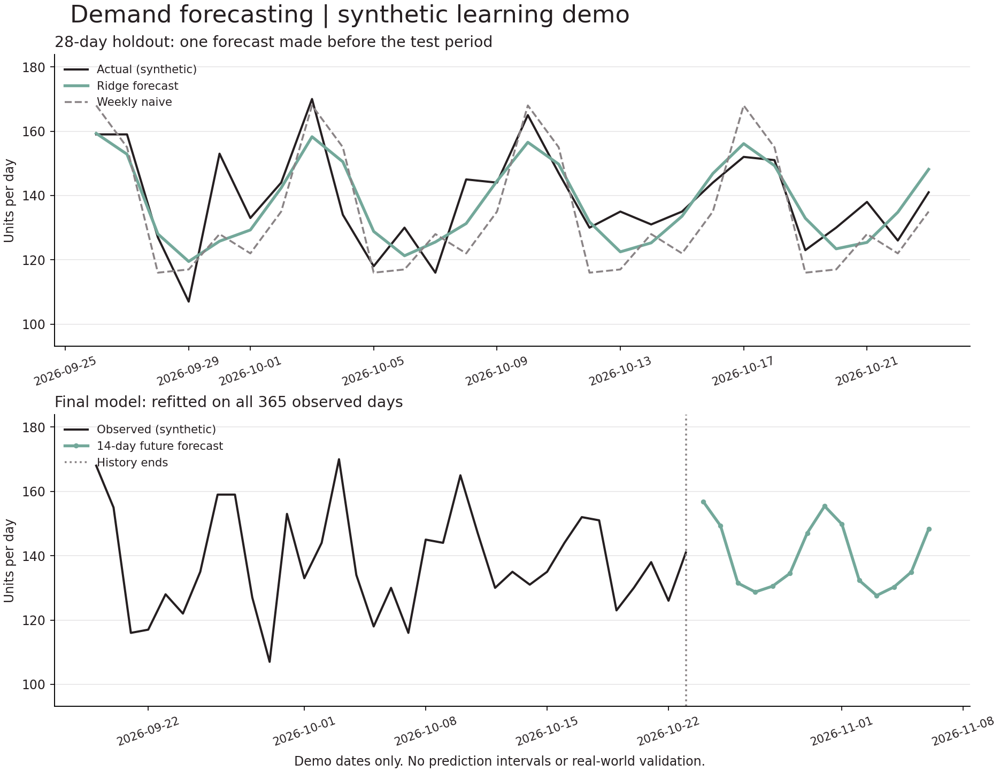

# Daily demand forecasting

A **learning prototype** using Python, pandas and scikit-learn
to forecast one fictional retail product's daily demand. All observations are
synthetic. This is not a banking or insurance model and has no production use.

## Quick start

Tested with Python 3.10.12. Python 3.10 or 3.11 is recommended.

```bash
python -m venv .venv
# Windows:
.venv\Scripts\python -m pip install -r requirements.txt
.venv\Scripts\python forecast.py
.venv\Scripts\python -m unittest -v test_forecast.py
```

On macOS/Linux, create the environment with `python3 -m venv .venv` and use
`.venv/bin/python` in place of `.venv\Scripts\python` for the remaining commands.
Dependency installation needs internet access; forecasting is local and uses no
API keys, external services or private data. No web server is started.

Bundled data are ready to use. To recreate them with fixed seed 42:

```bash
.venv\Scripts\python generate_sample_data.py
```

This overwrites the synthetic CSV. Running `forecast.py` overwrites `outputs/`.

## Method

- 365 invented daily observations, 24 October 2025 to 23 October 2026.
- First 337 observations for model fitting; last 28 days held out chronologically.
  Lag creation leaves 323 training feature rows.
- Features: elapsed day, weekday sine/cosine, lag 7, lag 14 and the previous
  seven-day mean. Past-only demand features avoid target leakage.
- Training-only StandardScaler followed by Ridge regression, fixed alpha 10.
  No model or parameter selection using the test scores.
- Fixed-origin recursive 28-day holdout: later lags use earlier predictions,
  never the hidden test actuals. Both evaluation methods have the same cutoff.
- Baseline repeats the final seven observed days across the holdout.
- A separate final model refits on all 365 days and forecasts the next 14 days.

## Saved synthetic holdout results

| Model | MAE (units/day) | RMSE (units/day) |
| --- | ---: | ---: |
| Ridge | 7.52 | 9.57 |
| Weekly naive | 10.32 | 11.97 |

MAE is average absolute error, not accuracy percentage. These numbers describe
one artificial dataset and one test window, not real-world predictive quality.
Full-precision scores, date boundaries and versions are in `outputs/metrics.json`.
Future dates have no actual values, so no future accuracy has been measured.



## Files

- `forecast.py`: input validation, features, training, evaluation and chart.
- `generate_sample_data.py`: transparent sample generator.
- `test_forecast.py`: seven tests including past-only features, valid forecast
  horizon, reproducibility, baseline, invalid data and metric interpretation.
- `data/synthetic_daily_demand.csv`: labelled synthetic observations.
- `outputs/holdout_predictions.csv`: model/baseline vs synthetic actuals.
- `outputs/future_forecast.csv`: 14-day expected-unit estimates.
- `outputs/forecast_chart.png`: actual plotted output.

## Limitations

Synthetic demand was deliberately generated with trend, weekly seasonality,
noise and occasional shocks. The model does not receive the formula, but the
problem is still artificial and comparatively easy. A better holdout score here
does not establish performance on real demand.

Only one product and one holdout window are used. There are no stockouts,
prices, promotions, holidays, supply constraints or prediction intervals.
Fractional values are expected-unit estimates, not guaranteed orders. Recursive
forecasts can accumulate error. The loader intentionally accepts only explicitly
labelled synthetic data; real-data use requires a reviewed adaptation.

Before business use, obtain authorized data, distinguish observed sales from
unmet demand, check stockouts and missing periods, evaluate multiple historical
origins, compare methods and quantify uncertainty without tuning on a final test.

## Status

This repository is a learning exercise. The saved outputs come from an actual
Python run. No production deployment, real customer outcomes or regulatory
approval is claimed.

## API references

- https://scikit-learn.org/stable/modules/generated/sklearn.linear_model.Ridge.html
- https://pandas.pydata.org/docs/reference/api/pandas.DataFrame.shift.html

Stable documentation can describe newer releases; the tested versions are
pinned in `requirements.txt` and recorded in the metrics file.
